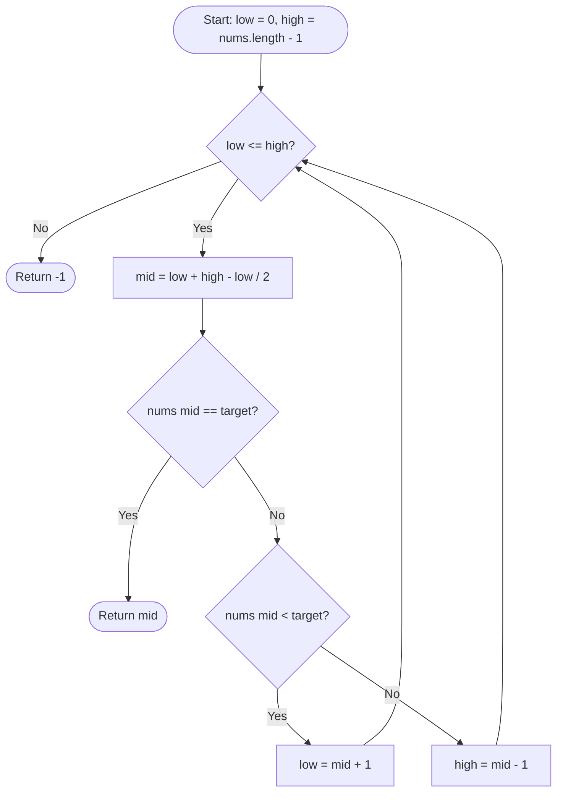

<h2><a href="https://leetcode.com/problems/binary-search">704. Binary Search</a></h2>

<p>Given an array of integers <code>nums</code> which is sorted in ascending order, and an integer <code>target</code>, write a function to search <code>target</code> in <code>nums</code>. If <code>target</code> exists, then return its index. Otherwise, return <code>-1</code>.</p>

<p>You must write an algorithm with <code>O(log n)</code> runtime complexity.</p>

<p>&nbsp;</p>
<p><strong class="example">Example 1:</strong></p>

<pre><strong>Input:</strong> nums = [-1,0,3,5,9,12], target = 9
<strong>Output:</strong> 4
<strong>Explanation:</strong> 9 exists in nums and its index is 4
</pre>

<p><strong class="example">Example 2:</strong></p>

<pre><strong>Input:</strong> nums = [-1,0,3,5,9,12], target = 2
<strong>Output:</strong> -1
<strong>Explanation:</strong> 2 does not exist in nums so return -1
</pre>

<p>&nbsp;</p>
<p><strong>Constraints:</strong></p>

<ul>
	<li><code>1 &lt;= nums.length &lt;= 10<sup>4</sup></code></li>
	<li><code>-10<sup>4</sup> &lt; nums[i], target &lt; 10<sup>4</sup></code></li>
	<li>All the integers in <code>nums</code> are <strong>unique</strong>.</li>
	<li><code>nums</code> is sorted in ascending order.</li>
</ul>


---

# 🛍️ Binary-Search | Explained

## Approach 1: Iterative Two-Pointer Binary Search
### Intuition
Imagine searching for a specific name in a massive, alphabetically sorted physical telephone directory. You wouldn't flip through the book page by page from the very beginning. Instead, you open the book roughly to the middle. If the name you see is alphabetically later than your target, you instantly know that your target cannot exist in the second half of the book. You discard that entire half and repeat the process on the remaining front half. 

Because the array `nums` is already sorted in ascending order, every element at index `mid` acts as a partition. Comparing `nums[mid]` with `target` eliminates half of the remaining search space in constant time.

### Algorithm Visualized


### Approach
1. **Define the Search Window:** Initialize two boundary pointers: `low = 0` (inclusive lower bound) and `high = nums.length - 1` (inclusive upper bound). The search space is represented by the closed interval `[low, high]`.
2. **Loop Condition (`low <= high`):** Continue narrowing the search window as long as it contains at least one valid candidate. When `low == high`, there is still one element left to evaluate.
3. **Safe Midpoint Calculation:** Compute the middle index `mid` using `low + (high - low) / 2` rather than `(low + high) / 2` to avoid 32-bit signed integer overflow.
4. **Three-Way Comparison:**
   - **Match Found:** If `nums[mid] == target`, return `mid` immediately.
   - **Target is Larger:** If `nums[mid] < target`, the target must reside in the right partition. Discard the left half and `mid` by shifting `low = mid + 1`.
   - **Target is Smaller:** If `nums[mid] > target`, the target must reside in the left partition. Discard the right half and `mid` by shifting `high = mid - 1`.
5. **Element Absent:** If the loop terminates (`low > high`) without a match, the target does not exist in the array. Return `-1`.

### Detailed Code Analysis
- `int low = 0; int high = nums.length - 1;`: Defines a closed search interval `[low, high]`. Both endpoints represent valid indices in the array.
- `while(low <= high)`: The loop invariant requires checking even when `low == high` because that single index could hold the target. Terminating when `low < high` would prematurely exit and miss the target if it lands on the single remaining element.
- `int mid = low + (high - low) / 2;`: Mathematically equivalent to `(low + high) / 2`, but prevents integer overflow. In Java, `low + high` can exceed `Integer.MAX_VALUE` ($2^{31} - 1$) if the array size is sufficiently large, resulting in a negative index and an `ArrayIndexOutOfBoundsException`.
- `if(nums[mid] == target) { return mid; }`: The base success case. Found the exact index, so we return immediately.
- `else if(nums[mid] < target) { low = mid + 1; }`: Since `nums[mid]` is strictly smaller than `target`, `mid` itself cannot be the answer. We shrink the window from the left to `mid + 1`.
- `else { high = mid - 1; }`: Since `nums[mid]` is strictly greater than `target`, `mid` cannot be the answer. We shrink the window from the right to `mid - 1`.
- `return -1;`: Reached only when the search interval becomes invalid (`low > high`), signifying that `target` is not present.

### Code
```java
class Solution {
    public int search(int[] nums, int target) {
        int low = 0;
        int high = nums.length - 1;
        while(low <= high){
            int mid = low + (high - low) / 2;
            if(nums[mid] == target){
                return mid;
            }
            else if(nums[mid] < target){
                low = mid + 1;
            }
            else{
                high = mid - 1;
            }
        }
        return -1;
    }
}
```

### Complexity
- **Time:** $O(\log n)$ — With every iteration of the `while` loop, the search space is halved ($n, n/2, n/4, \dots, 1$). The maximum number of steps required to reduce the space to size 1 is $\lfloor\log_2 n\rfloor + 1$.
- **Space:** $O(1)$ — The algorithm operates in-place using only three scalar variables (`low`, `high`, `mid`), requiring constant auxiliary memory.

---

## 🕵️‍♂️ Follow-up Questions (Optional)

1. **Why is `low + (high - low) / 2` preferred over `(low + high) >>> 1` or `(low + high) / 2`?**
   - While `(low + high) / 2` can overflow signed 32-bit integers, both `low + (high - low) / 2` and the unsigned right shift `(low + high) >>> 1` prevent this. `low + (high - low) / 2` is universally portable across languages that lack unsigned shifts (like Python or older C standards), whereas `>>>` is idiomatic in Java and often compiles down to a single CPU instruction.

2. **How would you adapt this solution if `nums` contained duplicate values and you needed to return the *first* (leftmost) occurrence of `target`?**
   - Instead of returning immediately when `nums[mid] == target`, you would continue searching to the left by setting `high = mid - 1` and recording `mid` as a potential candidate, or adjust the search invariant to find the lower bound (`low < high` with `high = mid`).