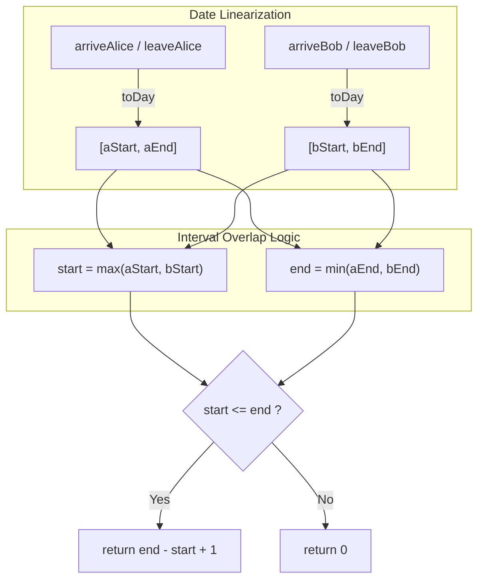

<h2><a href="https://leetcode.com/problems/count-days-spent-together">2409. Count Days Spent Together</a></h2>

<p>Alice and Bob are traveling to Rome for separate business meetings.</p>

<p>You are given 4 strings <code>arriveAlice</code>, <code>leaveAlice</code>, <code>arriveBob</code>, and <code>leaveBob</code>. Alice will be in the city from the dates <code>arriveAlice</code> to <code>leaveAlice</code> (<strong>inclusive</strong>), while Bob will be in the city from the dates <code>arriveBob</code> to <code>leaveBob</code> (<strong>inclusive</strong>). Each will be a 5-character string in the format <code>"MM-DD"</code>, corresponding to the month and day of the date.</p>

<p>Return<em> the total number of days that Alice and Bob are in Rome together.</em></p>

<p>You can assume that all dates occur in the <strong>same</strong> calendar year, which is <strong>not</strong> a leap year. Note that the number of days per month can be represented as: <code>[31, 28, 31, 30, 31, 30, 31, 31, 30, 31, 30, 31]</code>.</p>

<p>&nbsp;</p>
<p><strong class="example">Example 1:</strong></p>

<pre><strong>Input:</strong> arriveAlice = "08-15", leaveAlice = "08-18", arriveBob = "08-16", leaveBob = "08-19"
<strong>Output:</strong> 3
<strong>Explanation:</strong> Alice will be in Rome from August 15 to August 18. Bob will be in Rome from August 16 to August 19. They are both in Rome together on August 16th, 17th, and 18th, so the answer is 3.
</pre>

<p><strong class="example">Example 2:</strong></p>

<pre><strong>Input:</strong> arriveAlice = "10-01", leaveAlice = "10-31", arriveBob = "11-01", leaveBob = "12-31"
<strong>Output:</strong> 0
<strong>Explanation:</strong> There is no day when Alice and Bob are in Rome together, so we return 0.
</pre>

<p>&nbsp;</p>
<p><strong>Constraints:</strong></p>

<ul>
	<li>All dates are provided in the format <code>"MM-DD"</code>.</li>
	<li>Alice and Bob's arrival dates are <strong>earlier than or equal to</strong> their leaving dates.</li>
	<li>The given dates are valid dates of a <strong>non-leap</strong> year.</li>
</ul>


---

# 🛍️ Count-Days-Spent-Together | Explained

## Approach 1: Day-of-Year Linearization & 1D Interval Intersection

### Intuition
Dates formatted as `"MM-DD"` are cumbersome to compare directly across month boundaries because months have varying lengths (28, 30, or 31 days). 

Think of this problem like measuring overlapping shifts on a single timeline or overlapping segments on a ruler. Instead of juggling two separate units (months and days), we can project each date onto a continuous 1D timeline: the day of the year (from Day 1 to Day 365). 

Once both Alice and Bob's stays are converted into continuous closed intervals—$[aStart, aEnd]$ and $[bStart, bEnd]$—finding their time together reduces to the classic 1D interval intersection formula:
- The overlap starts at the **latest arrival**: $\max(aStart, bStart)$
- The overlap ends at the **earliest departure**: $\min(aEnd, bEnd)$

If the computed start is less than or equal to the computed end, an overlap exists, and the inclusive length is simply $\text{end} - \text{start} + 1$. Otherwise, they were never there at the same time, giving $0$ days.

### Algorithm Visualized



### Approach
1. **Define Days per Month**: Initialize a fixed array `days` representing the number of days in each month from January to December for a non-leap year (as specified by the problem constraints).
2. **Linearize Dates (`toDay`)**:
   - Extract the month `m` and day `d` directly from the `"MM-DD"` string using fast character arithmetic.
   - Accumulate the days of all full months prior to `m` (i.e., from index `0` to `m - 2`).
   - Add the current day `d` to produce an absolute day index between $1$ and $365$.
3. **Calculate the Intersection**:
   - Compute `start = Math.max(aStart, bStart)` to determine when both individuals are present.
   - Compute `end = Math.min(aEnd, bEnd)` to determine when the first person departs.
4. **Determine Duration**:
   - If `start <= end`, return the inclusive duration: `end - start + 1`.
   - If `start > end`, the intervals do not overlap; return `0`.

### Detailed Code Analysis

```java
class Solution {
    public int countDaysTogether(String arriveAlice, String leaveAlice, String arriveBob, String leaveBob) {
        // Step 1: Predefine the days in each month for a standard non-leap year (365 days total)
        int[] days = {31, 28, 31, 30, 31, 30, 31, 31, 30, 31, 30, 31};
        
        // Step 2: Convert each date string into a single scalar value: the day-of-year index [1, 365]
        int aStart = toDay(arriveAlice, days);
        int aEnd = toDay(leaveAlice, days);
        int bStart = toDay(arriveBob, days);
        int bEnd = toDay(leaveBob, days);
        
        // Step 3: Find the overlapping interval boundaries
        int start = Math.max(aStart, bStart); // Overlap cannot begin until both have arrived
        int end = Math.min(aEnd, bEnd);       // Overlap ends when the first person leaves
        
        // Step 4: Validate if the intersection interval is non-empty
        // Adding 1 accounts for both the start day and end day being inclusive
        return start <= end ? end - start + 1 : 0;
    }

    private int toDay(String s, int[] days) {
        // Fast numeric conversion using ASCII values avoiding substring() allocations
        // '0' has ASCII value 48. (s.charAt(i) - '0') yields the integer digit.
        int m = (s.charAt(0) - '0') * 10 + (s.charAt(1) - '0');
        int d = (s.charAt(3) - '0') * 10 + (s.charAt(4) - '0');
        
        // Accumulate full days elapsed in the preceding months
        int res = d;
        for (int i = 0; i < m - 1; i++) {
            res += days[i];
        }
        return res;
    }
}
```

- **Optimized Character Parsing**: Rather than using `Integer.parseInt(s.substring(...))`, which incurs heap allocation for new `String` objects, the `toDay` helper parses characters via `(s.charAt(i) - '0')`. This is memory-neutral and extremely cache-friendly.
- **Prefix Summation on the Fly**: The loop `for (int i = 0; i < m - 1; i++) res += days[i];` runs at most 11 iterations, avoiding precalculating a prefix sum array while keeping memory overhead at absolute zero.
- **Inclusive Range Invariant**: Range lengths on discrete grids are computed via $\text{right} - \text{left} + 1$. The boundary condition `start <= end` guarantees that if `start == end`, the result is `1` (they spent that exact single day together).

### Code
```java
class Solution {
    public int countDaysTogether(String arriveAlice, String leaveAlice, String arriveBob, String leaveBob) {
        int[] days = {31, 28, 31, 30, 31, 30, 31, 31, 30, 31, 30, 31};
        int aStart = toDay(arriveAlice, days);
        int aEnd = toDay(leaveAlice, days);
        int bStart = toDay(arriveBob, days);
        int bEnd = toDay(leaveBob, days);
        int start = Math.max(aStart, bStart);
        int end = Math.min(aEnd, bEnd);
        return start <= end ? end - start + 1 : 0;
    }
    private int toDay(String s, int[] days) {
        int m = (s.charAt(0) - '0') * 10 + (s.charAt(1) - '0');
        int d = (s.charAt(3) - '0') * 10 + (s.charAt(4) - '0');
        int res = d;
        for (int i = 0; i < m - 1; i++) res += days[i];
        return res;
    }
}
```

### Complexity
- **Time:** $O(1)$. All date strings are fixed at $5$ characters. The `toDay` method performs at most $11$ additions, and constant-time math is used to find the intersection.
- **Space:** $O(1)$. The `days` array has a constant size of $12$ elements, and only a few primitive integer registers are used. No dynamic allocations occur on the heap.

---

## 🕵️‍♂️ Follow-up Questions (Optional)

1. **How would you adapt this solution if leap years were possible (e.g., input includes `"YYYY-MM-DD"`)?**
   - Add a helper method `isLeapYear(year)`: `(year % 4 == 0 && year % 100 != 0) || (year % 400 == 0)`.
   - If leap, adjust February's days in the lookup array from `28` to `29`. If the date range spans across multiple calendar years, project the date onto an epoch counter (like Unix Epoch days) by accumulating whole years before adding the day-of-year index.

2. **How does this scale if there are $N$ people instead of just Alice and Bob?**
   - If we need the days when **all** $N$ people are together: generalise the bounds to `start = max(all arrivals)` and `end = min(all departures)`. The time remains $O(N)$ with $O(1)$ space.
   - If we need the maximum number of people present at any given day or the union of days someone was present: use a **Sweep-Line (Prefix Sum / Difference Array)** algorithm on an array of size 366, marking `+1` at arrivals and `-1` at `departures + 1`, running in $O(N + 365)$ time.