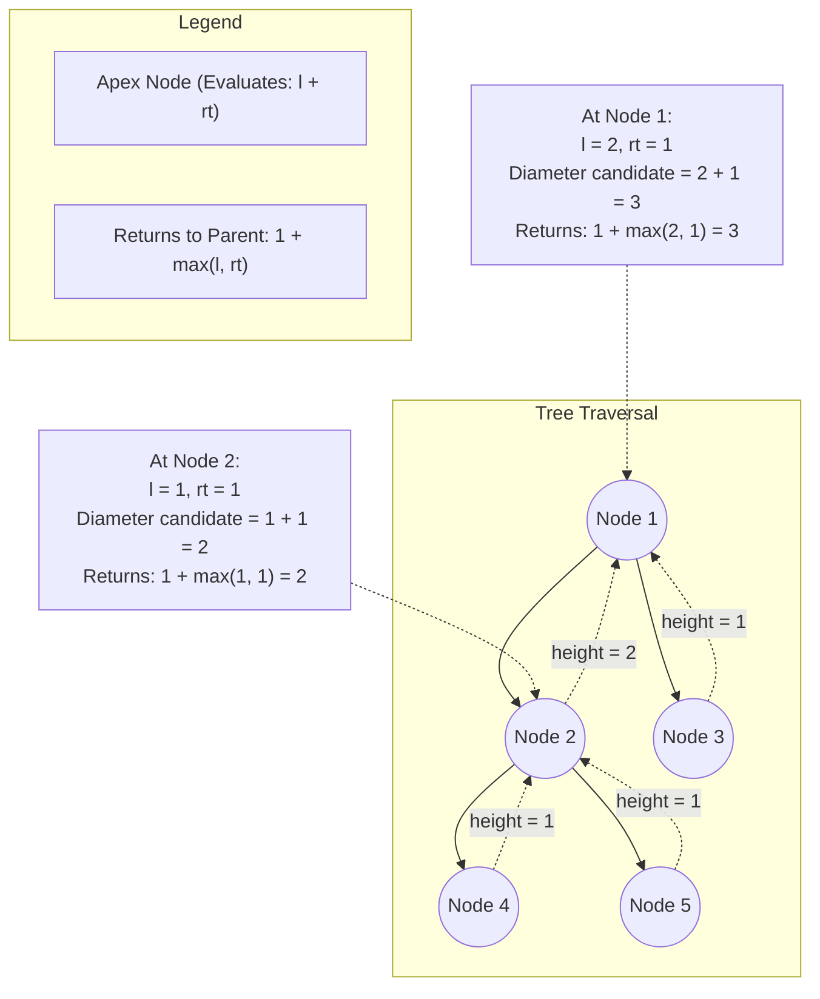

<h2><a href="https://leetcode.com/problems/diameter-of-binary-tree">543. Diameter of Binary Tree</a></h2>

<p>Given the <code>root</code> of a binary tree, return <em>the length of the <strong>diameter</strong> of the tree</em>.</p>

<p>The <strong>diameter</strong> of a binary tree is the <strong>length</strong> of the longest path between any two nodes in a tree. This path may or may not pass through the <code>root</code>.</p>

<p>The <strong>length</strong> of a path between two nodes is represented by the number of edges between them.</p>

<p>&nbsp;</p>
<p><strong class="example">Example 1:</strong></p>

<pre><strong>Input:</strong> root = [1,2,3,4,5]
<strong>Output:</strong> 3
<strong>Explanation:</strong> 3 is the length of the path [4,2,1,3] or [5,2,1,3].
</pre>

<p><strong class="example">Example 2:</strong></p>

<pre><strong>Input:</strong> root = [1,2]
<strong>Output:</strong> 1
</pre>

<p>&nbsp;</p>
<p><strong>Constraints:</strong></p>

<ul>
	<li>The number of nodes in the tree is in the range <code>[1, 10<sup>4</sup>]</code>.</li>
	<li><code>-100 &lt;= Node.val &lt;= 100</code></li>
</ul>


---

# 🛍️ Diameter-of-Binary-Tree | Explained

## Approach 1: Bottom-Up Post-Order DFS with Global State
### Intuition
Think of each node in the binary tree as a bridge or a summit between two valleys (its left and right subtrees). 

If a path uses a specific node as its highest point (the apex), that path must travel as deep as possible down the left subtree, pass through the node, and continue as deep as possible down the right subtree. The length of this path (in number of edges) is simply the maximum depth of the left subtree plus the maximum depth of the right subtree. 

However, when this node communicates upward to its own parent, it cannot offer both branches—a path cannot fork and remain a valid simple path. It can only offer its single deepest branch (the greater of its left or right height) plus the edge connecting itself to the parent. By computing heights from the leaves upward (post-order traversal), we can evaluate the maximum path passing through every single node as an apex while simultaneously bubbling up the heights needed for ancestor nodes.

### Algorithm Visualized



### Approach
1. **Maintain Global Diameter Tracker**: Declare an instance variable `diameter` initialized to `0` to keep track of the maximum edge count found across all nodes.
2. **Execute Post-Order DFS**:
   - **Base Case**: If the current node `r` is `null`, its height is `0`.
   - **Recursive Step (Divide)**: Recursively compute the height of the left child (`l`) and right child (`rt`).
   - **Evaluate Diameter at Current Node (Conquer)**: The longest path with node `r` as its highest turning point has length `l + rt` (edges). Update `diameter = Math.max(diameter, l + rt)`.
   - **Return Height to Parent**: A parent node can only extend one path downwards. Therefore, return `1 + Math.max(l, rt)` to represent the height of the subtree rooted at `r`.
3. **Return Result**: Once the traversal finishes, the variable `diameter` contains the longest path between any two nodes in the tree.

### Detailed Code Analysis

- **Line 17: `int diameter=0;`**
  - Defines an instance variable to hold the maximum diameter found so far. Using a class-level variable avoids having to wrap multiple return values (such as both height and diameter) in an object or array.

- **Lines 18–21: `public int diameterOfBinaryTree(TreeNode root)`**
  - The public entry point. It triggers the recursive traversal `height(root)`.
  - Even though `height(root)` returns the maximum depth of the entire tree, we ignore its final return value and instead return `diameter`, which was continuously updated as a side effect during traversal.

- **Lines 22–23: `private int height(TreeNode r) { if(r==null) return 0;`**
  - The recursive helper function designed to compute subtree height.
  - Base case: If the node is `null`, it contributes `0` to the path height, terminating the recursion for that branch.

- **Line 24: `int l=height(r.left), rt=height(r.right);`**
  - Post-order traversal (`Left -> Right -> Root`). The algorithm descends to the bottom of the tree first.
  - `l` stores the maximum number of nodes from `r.left` down to a leaf.
  - `rt` stores the maximum number of nodes from `r.right` down to a leaf.

- **Line 25: `diameter=Math.max(diameter,l+rt);`**
  - Calculates the longest path that bends at node `r`.
  - Since `l` is the number of nodes along the deepest left path and `rt` is the number of nodes along the deepest right path, `l + rt` represents the total number of edges connecting those two paths through node `r`.
  - Compares this value against `diameter` and updates it if the current path is longer.

- **Line 26: `return 1+Math.max(l,rt);`**
  - Returns the height of the subtree rooted at `r` back up to its parent.
  - Adds `1` (accounting for the current node `r` itself) to the maximum depth of either the left or right branch.

### Code
```java
/**
 * Definition for a binary tree node.
 * public class TreeNode {
 *     int val;
 *     TreeNode left;
 *     TreeNode right;
 *     TreeNode() {}
 *     TreeNode(int val) { this.val = val; }
 *     TreeNode(int val, TreeNode left, TreeNode right) {
 *         this.val = val;
 *         this.left = left;
 *         this.right = right;
 *     }
 * }
 */
class Solution {
    int diameter = 0;

    public int diameterOfBinaryTree(TreeNode root) {
        height(root);
        return diameter;
    }

    private int height(TreeNode r) {
        if (r == null) return 0;
        int l = height(r.left);
        int rt = height(r.right);
        diameter = Math.max(diameter, l + rt);
        return 1 + Math.max(l, rt);
    }
}
```

### Complexity
- **Time: $O(N)$**
  - Where $N$ is the total number of nodes in the binary tree.
  - Every node is visited exactly once during the post-order depth-first search. At each node, computing the maximum and addition are $O(1)$ operations.
- **Space: $O(H)$**
  - Where $H$ is the height of the tree, representing the memory used by the implicit recursion call stack.
  - **Worst Case:** $O(N)$ when the tree is completely skewed (like a linked list).
  - **Best/Average Case:** $O(\log N)$ when the tree is balanced.

---

## 🕵️‍♂️ Follow-up Questions (Optional)

1. **How can you solve this without using a class-level/instance variable?**
   - In multi-threaded environments, instance variables can lead to race conditions. You can avoid class-level state by passing a single-element array (e.g., `int[] max = new int[1]`) down through recursion parameters, or by having the helper function return a custom object or tuple containing both the current subtree's `height` and the maximum `diameter` observed within that subtree:
     ```java
     // Example return structure: [height, max_diameter]
     int[] dfs(TreeNode root) { ... }
     ```

2. **What if the problem asked for the actual path (node values) rather than just the diameter length?**
   - You would maintain a global list of nodes alongside the maximum diameter. When a new maximum `l + rt` is identified at an apex node, you would reconstruct the path by tracing the deepest downward path from `r.left`, appending `r.val`, and appending the deepest downward path from `r.right`.