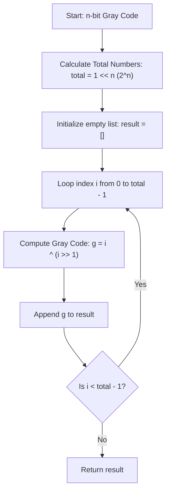

<h2><a href="https://leetcode.com/problems/gray-code">89. Gray Code</a></h2>

<p>An <strong>n-bit gray code sequence</strong> is a sequence of <code>2<sup>n</sup></code> integers where:</p>

<ul>
	<li>Every integer is in the <strong>inclusive</strong> range <code>[0, 2<sup>n</sup> - 1]</code>,</li>
	<li>The first integer is <code>0</code>,</li>
	<li>An integer appears <strong>no more than once</strong> in the sequence,</li>
	<li>The binary representation of every pair of <strong>adjacent</strong> integers differs by <strong>exactly one bit</strong>, and</li>
	<li>The binary representation of the <strong>first</strong> and <strong>last</strong> integers differs by <strong>exactly one bit</strong>.</li>
</ul>

<p>Given an integer <code>n</code>, return <em>any valid <strong>n-bit gray code sequence</strong></em>.</p>

<p>&nbsp;</p>
<p><strong class="example">Example 1:</strong></p>

<pre><strong>Input:</strong> n = 2
<strong>Output:</strong> [0,1,3,2]
<strong>Explanation:</strong>
The binary representation of [0,1,3,2] is [00,01,11,10].
- 0<u>0</u> and 0<u>1</u> differ by one bit
- <u>0</u>1 and <u>1</u>1 differ by one bit
- 1<u>1</u> and 1<u>0</u> differ by one bit
- <u>1</u>0 and <u>0</u>0 differ by one bit
[0,2,3,1] is also a valid gray code sequence, whose binary representation is [00,10,11,01].
- <u>0</u>0 and <u>1</u>0 differ by one bit
- 1<u>0</u> and 1<u>1</u> differ by one bit
- <u>1</u>1 and <u>0</u>1 differ by one bit
- 0<u>1</u> and 0<u>0</u> differ by one bit
</pre>

<p><strong class="example">Example 2:</strong></p>

<pre><strong>Input:</strong> n = 1
<strong>Output:</strong> [0,1]
</pre>

<p>&nbsp;</p>
<p><strong>Constraints:</strong></p>

<ul>
	<li><code>1 &lt;= n &lt;= 16</code></li>
</ul>


---

# 🛍️ Gray-Code | Explained

## Approach 1: Direct Bitwise Transformation (Binary to Gray Code)
### Intuition
Think of a rotary mechanical encoder (like a digital volume knob or a wind-vane sensor). If the encoder used standard binary, transitioning from position $3$ (`011`) to position $4$ (`100`) would require three physical electrical contacts to switch simultaneously. Because mechanical switches never switch at the exact same millisecond, the sensor would briefly read intermediate, erroneous values (such as `111` or `000`). 

A Gray code fixes this by guaranteeing that between any two consecutive values, exactly **one** bit changes.

The standard binary index $i$ can be directly transformed into its corresponding Gray code value using the bitwise operation:
$$G(i) = i \oplus \lfloor i / 2 \rfloor = i \oplus (i \gg 1)$$

Why does this work?
In binary, incrementing an index toggles the least significant bit (LSB) and potentially flips a cascade of higher-order bits due to carries (e.g., `0111` + `1` = `1000`). When you compute $i \oplus (i \gg 1)$:
1. The highest set bit of $i$ remains unchanged because it is XORed with a $0$.
2. Any trailing sequence of carries flips both $i$ and $i \gg 1$ in a synchronized manner such that all differences cancel out via XOR, leaving only a single bit toggled across adjacent Gray values $G(i)$ and $G(i+1)$.

### Algorithm Visualized



#### Bitwise Transformation Example ($n = 2$):

| Index $i$ (Binary) | $i \gg 1$ | $G(i) = i \oplus (i \gg 1)$ | Gray Code (Binary) | Gray Code (Decimal) |
| :--- | :--- | :--- | :--- | :--- |
| $0$ (`00`) | `00` | `00 ^ 00` | `00` | $0$ |
| $1$ (`01`) | `00` | `01 ^ 00` | `01` | $1$ |
| $2$ (`10`) | `01` | `10 ^ 01` | `11` | $3$ |
| $3$ (`11`) | `01` | `11 ^ 01` | `10` | $2$ |

Notice how each sequential output differs by only $1$ bit:
`00` $\to$ `01` $\to$ `11` $\to$ `10` $\to$ (wraps back to `00` with 1 bit change).

### Approach
1. **Determine the sequence length**: For an $n$-bit Gray code, there are $2^n$ unique numbers. Compute this efficiently using the bitwise left shift operator: `1 << n`.
2. **Iterate linearly**: Traverse indices from $0$ up to $2^n - 1$.
3. **Apply the binary-to-Gray formula**: For each index `i`, shift `i` right by 1 position (`i >> 1`) and compute the bitwise XOR (`^`) with `i`.
4. **Collect and Return**: Store each converted integer into a list and return the completed sequence.

### Detailed Code Analysis

```python
class Solution(object):
    def grayCode(self, n):
        """
        :type n: int
        :rtype: List[int]
        """
        result = []
        total_numbers = 1 << n

        for i in range(total_numbers):
            result.append(i ^ (i >> 1))

        return result
```

- **`total_numbers = 1 << n`**: 
  - Computes $2^n$ via a bit-shift. `1 << n` shifts the binary digit `1` to the left by `n` places. For $n = 3$, `1 << 3` evaluates to `1000` in binary, which is $8$ in decimal.
- **`result = []`**:
  - Initializes a dynamic array to hold the $2^n$ elements.
- **`for i in range(total_numbers):`**:
  - Sets up a loop running from $i = 0$ to $i = 2^n - 1$.
- **`result.append(i ^ (i >> 1))`**:
  - `i >> 1` shifts the bits of $i$ rightward by 1 position (equivalent to integer division by 2).
  - `^` is the bitwise XOR operator.
  - The combination generates the $i$-th Gray code integer in $O(1)$ time and appends it to `result`.
- **`return result`**:
  - Returns the generated sequence of length $2^n$.

### Code
```python
class Solution(object):
    def grayCode(self, n):
        result = []
        total_numbers = 1 << n

        for i in range(total_numbers):
            result.append(i ^ (i >> 1))

        return result
```

### Complexity
- **Time:** $O(2^n)$. Generating $2^n$ numbers requires iterating $2^n$ times. Each iteration performs bitwise operations (`>>`, `^`) and an append operation, which both execute in $O(1)$ time.
- **Space:** $O(1)$ auxiliary space (or $O(2^n)$ space including the output array `result`), as no extra memory structures (recursion stacks, hash maps, or visited sets) are allocated.

---

## 🕵️‍♂️ Follow-up Questions (Optional)

### 1. How would you solve this recursively/inductively without the direct mathematical formula?
You can build the $(n)$-bit Gray code from the $(n-1)$-bit Gray code using reflection:
1. Start with base case $n = 0 \to [0]$.
2. For each bit step from $1$ to $n$, take the existing list, reverse it, add $2^{k-1}$ (set the $k$-th bit) to each element in the reversed list, and append it to the original list.
This works because reversing the previous Gray code preserves the 1-bit difference property across the junction where the new prefix bit is added.

### 2. Can you convert a Gray code value back into its standard binary index?
Yes, using an inverse Gray-to-Binary function:
```python
def grayToBinary(g):
    b = 0
    while g > 0:
        b ^= g
        g >>= 1
    return b
```
Because Gray code bit $k$ is the prefix XOR sum of binary bits from the MSB down to bit $k$, repeatedly shifting and XORing recovers the original binary index.